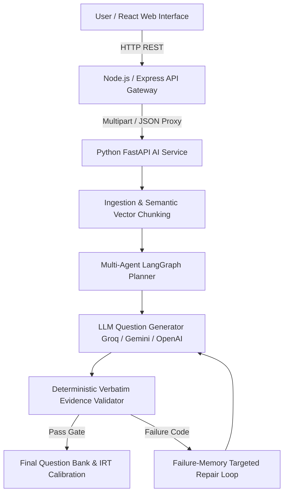

# Questrix AI — Agentic AI Question Paper Generator

**Questrix AI** is a curriculum-grounded, multi-agent AI Question Paper Generator and Verbatim Evidence Validator powered by **CAL-QG** (*Calibrated, evidence-Anchored, failure-Learning Question Generation*).

It allows educators and academic institutions to ingest syllabus documents (PDF/MD/TXT), generate balanced question papers matching Bloom's Taxonomy, and automatically verify answerability and grounding against retrieved source material without self-evaluation LLM bias.

---

## 🏗️ Architecture & Decoupled Workflow

Questrix AI is organized into three decoupled microservice directories:

```
Questrix/
├── frontend/        # React.js + Vite + Tailwind CSS User Interface (Port 5173)
├── backend/         # Node.js + Express REST API Gateway (Port 5000)
└── ai-service/      # Python FastAPI + Multi-Agent CAL-QG RAG Engine (Port 8000)
```



### 🔄 Multi-Agent Generation Workflow

1. **Syllabus Ingestion**: PDF/MD documents are processed into semantic vector chunks and concept maps.
2. **Coverage-Aware Planning**: Allocates Bloom Taxonomy levels using largest-remainder algorithm over concept coverage deficits.
3. **Question Generation**: LLMs (Groq `qwen/qwen3.8-27b`, Gemini `gemini-2.5-flash`, OpenAI) generate questions constrained by retrieved context.
4. **Hard-Gate Validation**:
   - **Answerability & Verbatim Grounding**: Verifies questions against verbatim source text spans rather than LLM self-grading.
   - **Bloom Taxonomy Classifier**: Rule-based classifier checks verb alignment.
5. **Failure-Memory Repair Loop**: Emits failure codes (`UNGROUNDED`, `BLOOM_MISMATCH`) and feeds them back into targeted prompt repair constraints.
6. **IRT Difficulty Calibration**: Rasch model calibrates question difficulty based on item features and response matrices.

---

## 🛠️ Technology Stack

| Component | Technologies Used |
|---|---|
| **Frontend** | React 18, Vite, Tailwind CSS, Lucide React icons, Fetch API |
| **Backend API Gateway** | Node.js (v22+), Express.js, Multer (multipart form handling), CORS |
| **AI / RAG Engine** | Python 3.14, FastAPI, Uvicorn, LangGraph, Scikit-learn, NumPy, TF-IDF / Neural Embeddings, pdfplumber, pypdf |
| **LLM Providers** | Groq SDK (`qwen/qwen3.8-27b`), Google Gemini API (`gemini-2.5-flash`), OpenAI API, Offline Mock LLM |

---

## 🚀 How to Run the Application

### ⚡ 1-Click Launch (Windows)
Double-click **`start.bat`** in the project root folder (or run `./start.bat` in terminal). It will automatically open 3 terminal windows and launch all three services!

---

### Manual Launch (Step-by-Step)

### Prerequisites
* **Node.js**: v18.0.0 or higher ([Download Node.js](https://nodejs.org/))
* **Python**: v3.10 or higher ([Download Python](https://www.python.org/))

---

### Step 1: Configure & Start the Python AI Engine (`ai-service/`)

1. Open terminal in `ai-service/`:
   ```bash
   cd ai-service
   ```
2. Install Python dependencies:
   ```bash
   python -m pip install -r requirements.txt
   ```
3. Set up environment variables:
   Create a `.env` file inside `ai-service/` (or copy `.env.example`):
   ```env
   # API Keys (Provide at least one key, or leave empty to run offline Mock LLM)
   GROQ_API_KEY=your_groq_api_key_here
   GEMINI_API_KEY=your_gemini_api_key_here

   # Model Selection
   CALQG_LLM=auto
   GROQ_MODEL=qwen/qwen3.8-27b
   GEMINI_MODEL=gemini-2.5-flash
   OPENAI_MODEL=gpt-4o-mini
   ```
4. Launch the FastAPI server:
   ```bash
   uvicorn calqg.api:app --reload --port 8000
   ```
   *Service will run on `http://localhost:8000` (Health check: `http://localhost:8000/health`).*

---

### Step 2: Start the Express API Gateway (`backend/`)

Open a **new terminal**:

1. Navigate to `backend/`:
   ```bash
   cd backend
   ```
2. Install Node dependencies:
   ```bash
   npm install
   ```
3. Start the Express server:
   ```bash
   npm run dev
   ```
   *Backend API Gateway will run on `http://localhost:5000`.*

---

### Step 3: Start the React Web Interface (`frontend/`)

Open a **third terminal**:

1. Navigate to `frontend/`:
   ```bash
   cd frontend
   ```
2. Install Node dependencies:
   ```bash
   npm install
   ```
3. Start Vite dev server:
   ```bash
   npm run dev
   ```
4. Open your browser and navigate to:
   **[http://localhost:5173](http://localhost:5173)**

---

## 📝 Usage Guide

1. **Enter Exam Requirements**: Set Subject Name (e.g. *Data Structures & Algorithms*), Question Count, Question Type, and Marks per question.
2. **Upload Syllabus Material**: Drag & drop or upload a syllabus unit file (PDF / MD / TXT). You can also click **DS & Algo Preset** or **Java OOP Preset** for 1-click test configurations.
3. **Select Bloom Levels**: Check target cognitive levels (*Remember, Understand, Apply, Analyze, Evaluate, Create*).
4. **Generate Question Paper**: Click **Generate Question Paper** to trigger the agentic QG pipeline.
5. **View & Export**: Review the generated academic paper with model answers and verbatim source evidence. Copy formatted text to clipboard or download as `.md`.